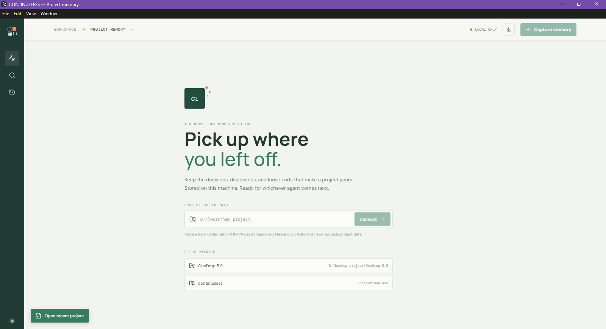
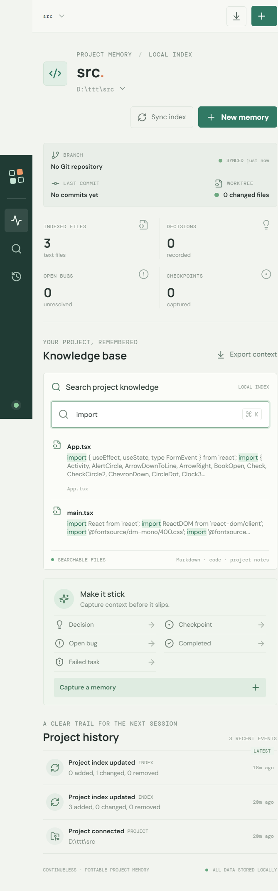
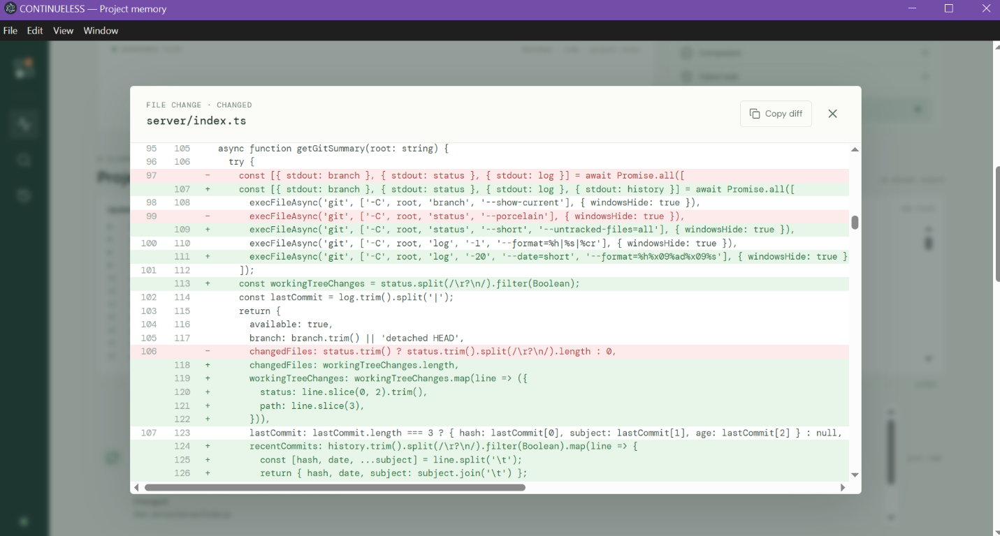

# CONTINUELESS

<p align="center">
  <strong>Portable memory for AI coding agents.</strong><br />
  Keep your project's architecture, decisions, progress, and next steps—so you can pick up where you left off.
</p>

<p align="center">
  <a href="https://github.com/Thilankalhara/-CONTINUELESS/blob/main/LICENSE"></a>
  
  
</p>

<p align="center">
  <a href="https://github.com/Thilankalhara/-CONTINUELESS/releases/download/v1.1.0/CONTINUELESS-1.1.0-win-x64.exe"></a>
  <a href="https://github.com/Thilankalhara/-CONTINUELESS/releases/tag/v1.1.0"></a>
  <a href="https://github.com/Thilankalhara/-CONTINUELESS/releases/download/v1.1.0/CONTINUELESS-1.1.0-linux-x86_64.AppImage"></a>
</p>

Switching between AI coding assistants can mean losing the project context you have already explained: how the architecture fits together, what has been tried, and what still needs doing. CONTINUELESS is a local application that gives that context a persistent home.

Connect a project folder to index its text files, record decisions and work history, and search files and notes together. When you switch tools or sessions, export the project context as Markdown and provide it to your AI coding assistant.

Your project files, index, and saved memories stay on your machine. CONTINUELESS does not upload them.

## Core capabilities

- **Local project indexing:** Build a searchable index of supported project text files.
- **Git integration:** View the current branch, most recent commit, and working-tree changes.
- **Persistent memory:** Store project indexes, activity, and notes in a local SQLite database.
- **Change detection:** Sync the index manually or let CONTINUELESS refresh it automatically while open.
- **Project history:** Record architectural decisions, task checkpoints, open bugs, completed work, and failed tasks. Review indexed file changes, open per-file diffs, and copy them for an AI handoff.
- **Searchable knowledge:** Search indexed project files and saved memories together.
- **Portable context:** Export saved memories and an indexed-file list as Markdown for use with AI coding tools.
- **Project dashboard:** Review project status, memory counts, recent history, and search from one place.

## Screenshots

<p align="center">
  
</p>

<p align="center"><em>Project dashboard: see project status and find indexed files and saved memories.</em></p>

<p align="center">
  
</p>

<p align="center"><em>Search project files and notes together from the local index.</em></p>

<p align="center">
  
</p>

<p align="center"><em>Open a changed file from project history to review and copy its color-coded diff.</em></p>

## Install the desktop app

### CONTINUELESS v1.1.0

| Operating system | Download |
| --- | --- |
| Windows (64-bit) | [Download the Windows installer](https://github.com/Thilankalhara/-CONTINUELESS/releases/download/v1.1.0/CONTINUELESS-1.1.0-win-x64.exe) |
| macOS (Apple Silicon) | [Download the DMG](https://github.com/Thilankalhara/-CONTINUELESS/releases/download/v1.1.0/CONTINUELESS-1.1.0-mac-arm64.dmg) · [Download the ZIP](https://github.com/Thilankalhara/-CONTINUELESS/releases/download/v1.1.0/CONTINUELESS-1.1.0-mac-arm64.zip) |
| macOS (Intel) | [Download the DMG](https://github.com/Thilankalhara/-CONTINUELESS/releases/download/v1.1.0/CONTINUELESS-1.1.0-mac-x64.dmg) · [Download the ZIP](https://github.com/Thilankalhara/-CONTINUELESS/releases/download/v1.1.0/CONTINUELESS-1.1.0-mac-x64.zip) |
| Linux (64-bit) | [Download the AppImage](https://github.com/Thilankalhara/-CONTINUELESS/releases/download/v1.1.0/CONTINUELESS-1.1.0-linux-x86_64.AppImage) · [Download the DEB package](https://github.com/Thilankalhara/-CONTINUELESS/releases/download/v1.1.0/CONTINUELESS-1.1.0-linux-amd64.deb) |

See the [full v1.1.0 release page](https://github.com/Thilankalhara/-CONTINUELESS/releases/tag/v1.1.0) for all downloads and release notes. If an asset is not available immediately, wait for the cross-platform release build to finish, or check the [releases page](https://github.com/Thilankalhara/-CONTINUELESS/releases) for the latest version. The earlier [v1.0.0 release](https://github.com/Thilankalhara/-CONTINUELESS/releases/tag/v1.0.0) remains available.

Install or open the download, launch CONTINUELESS, and connect a project folder from the welcome screen. The desktop app runs its local API itself; you do not need to keep a terminal open or install Node.js.

Installers are not currently signed with platform-specific code-signing certificates, so Windows or macOS may show a security warning when you first open them.

## Run from source

Use these steps if you want to work on the code or run the browser version during development.

### 1. Install the prerequisites

- [Node.js](https://nodejs.org/) **22.12 or newer** for running or building from source.
- npm, which is included with Node.js.
- [Git](https://git-scm.com/downloads) is optional, but needed to show Git branch, commit, and working-tree information for a connected project.

### 2. Download the project

Open a terminal and clone this repository:

```bash
git clone https://github.com/Thilankalhara/-CONTINUELESS.git continueless
cd continueless
```

On Windows, you can run these commands in PowerShell too.

### 3. Install dependencies

```bash
npm install
```

### 4. Start the development version

```bash
npm run dev
```

When the servers are ready, open **http://127.0.0.1:5173** in your browser. Leave the terminal running while you use the app. Press **Ctrl+C** in that terminal to stop it.

To build and open the desktop app from source instead, run:

```bash
npm run desktop
```

This builds the frontend and server, rebuilds SQLite for Electron, and opens the desktop window.

### 5. Connect a project

1. Copy the full path to a project folder on your computer.
2. Paste the path into the **Project folder path** field in CONTINUELESS. For example:
   - Windows: `C:\Users\you\work\my-project`
   - macOS/Linux: `/Users/you/work/my-project`
3. Select **Connect** and wait for the initial index to finish.
4. Search the project, capture a memory, or export its context.

The same folder can be reopened from the recent-project list the next time you run CONTINUELESS.

## How to work with CONTINUELESS

1. **Connect your working project.** Start the app, enter the full path to a project folder, and select **Connect**. CONTINUELESS indexes supported text files locally and, if the folder is a Git repository, reads its branch and recent status.
2. **Capture context as you work.** Select **New memory** or **Capture memory**, choose a type, and write a descriptive title and note. Record decisions with their reasoning, checkpoints with completed and remaining work, bugs with reproduction details, and failed approaches with what you learned.
3. **Find information again.** Search with at least two characters to look across indexed project files and saved memories. Press **Ctrl+K** (or **⌘K** on macOS) to focus search.
4. **Keep the index current.** Choose **Sync index** after making changes. While the app is open, it also checks for project changes automatically.
   Project history lists detected file additions, edits, and removals. Select a file to compare its previous and current indexed contents; additions appear green and removals red. Use **Copy diff** to copy the comparison.
5. **Bring context to another tool or session.** Select **Export context** to refresh the index and download an AI-friendly Markdown handoff containing project overview and workflow sections from the README, package metadata and common commands when available, current status, your latest checkpoint and next steps, completed-work notes, open bugs, saved decisions, the 20 most recent Git commits, current changed-file names, and the indexed-file list. Open that file or paste it into your AI coding assistant when you start working in the project. Git details require Git and a Git repository. The summary uses project documentation and metadata; CONTINUELESS does not generate an AI-written summary or automatically send context to an AI assistant.

### A simple day-to-day workflow

- At the beginning of a session, search for the latest checkpoint and unresolved bugs.
- During work, capture important decisions and discoveries while they are fresh. Git commits and uncommitted changes are included automatically in the next export; no memory is needed for every code edit. Save a checkpoint before switching sessions to give the next assistant your intended next steps.
- Before switching assistants or ending a session, save a checkpoint with what changed and the next steps.
- Export context when you need to provide that project history to another tool.

## What is indexed and where data is stored

CONTINUELESS indexes supported text and source files up to **512 KB each**. It skips common generated or dependency folders such as `.git`, `node_modules`, `dist`, and `build`, as well as binary files. It reads the folder you explicitly connect; it does not modify your project files.

The installed desktop app stores its database in Electron's per-user application-data folder (the `userData` folder). When running from source, the database is `.continueless/memory.sqlite` in the app's working directory unless `CONTINUELESS_DATA_DIR` is set. The `.continueless/` directory is ignored by Git in this repository. Keep a copy of the database if you want to back up your local memory.

The local API only binds to `127.0.0.1`; the installed desktop app selects an available local port automatically. No project contents are sent to an external service.

## Developer commands

Run these commands from the repository folder:

| Command | What it does |
| --- | --- |
| `npm run dev` | Starts the local API and the Vite development server. |
| `npm run check` | Type-checks the app and server. |
| `npm run build` | Type-checks and builds the frontend into `dist/`. |
| `npm run desktop` | Builds and opens the desktop app from source. |
| `npm run dist` | Creates an installer for the current operating system. |
| `npm run dist:win` | Creates a Windows installer. |
| `npm run dist:mac` | Creates macOS disk-image and ZIP downloads. |
| `npm run dist:linux` | Creates Linux AppImage and Debian packages. |
| `npm run start` | Starts the local API server. |

The browser development server is available at `http://127.0.0.1:5173`; its API listens on `http://127.0.0.1:4175`. The Vite development server forwards `/api` requests to the API. Desktop installers are built natively on each operating system; use the matching command on Windows, macOS, or Linux.

### Publish installers

Pushing a version tag builds installers on Windows, macOS, and Linux, then attaches them to a GitHub Release. Update the version in `package.json`, commit the change, and push a matching tag:

```bash
git tag v1.0.1
git push origin v1.0.1
```

The installers are also available as build artifacts from the manually started **Build desktop installers** workflow in the repository's GitHub Actions tab.

### Optional local settings

The API reads these environment variables:

| Variable | Default | Purpose |
| --- | --- | --- |
| `PORT` | `4175` | Port for the local API server. |
| `CONTINUELESS_DATA_DIR` | `.continueless` | Directory for `memory.sqlite`, relative to the app's working directory unless an absolute path is given. |

For example, in PowerShell:

```powershell
$env:CONTINUELESS_DATA_DIR = "D:\local-data\continueless"
npm run dev
```

In macOS or Linux:

```bash
CONTINUELESS_DATA_DIR="$HOME/.local/share/continueless" npm run dev
```

## Troubleshooting

- **The page does not load:** Make sure `npm run dev` is still running, then open `http://127.0.0.1:5173`.
- **A port is already in use:** Stop the other process using that port, or set a different `PORT` for the API. If you change the API port, update the proxy target in `vite.config.ts` to match.
- **A folder will not connect:** Check that the path exists and that your user account can read it. Enter the path to the folder itself, not to a file inside it.
- **Git details are missing:** Install Git and make sure the `git` command is available in your terminal. The rest of the app can be used without a Git repository.
- **A file is missing from search:** Confirm it is a supported text file smaller than 512 KB, is not inside a skipped folder, and run **Sync index**.

## Contributing

Contributions are welcome. To make a change, create a branch, install dependencies with `npm install`, and run `npm run check` and `npm run build` before opening a pull request.

## License

CONTINUELESS is distributed under the [MIT License](LICENSE).